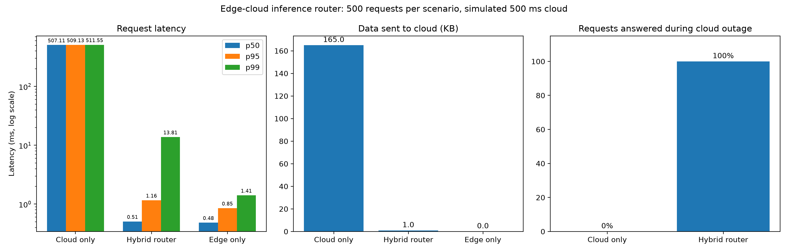
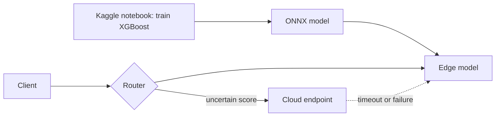

# Edge-Cloud Inference Router


A latency-first hybrid inference router. A small ONNX fraud model runs at the edge and answers confident requests in under a millisecond. Only uncertain requests are sent to a (simulated) cloud endpoint, and the system keeps answering when the cloud is down.



## Results

500 requests per scenario, same transactions in every scenario, cloud simulated with a 500 ms delay.

| Scenario | p50 (ms) | p95 (ms) | p99 (ms) | Handled at edge | Data sent to cloud | Answered during outage |
|---|---|---|---|---|---|---|
| Cloud only | 507.11 | 509.13 | 511.55 | 0% | 165.0 KB | 0% |
| Hybrid router | 0.51 | 1.16 | 13.81 | 99.4% | 1.0 KB | 100% |
| Edge only | 0.48 | 0.85 | 1.41 | 100% | 0 KB | 100% |

Hybrid sent 3 of 500 requests (0.6%) to the cloud, each taking about 500 ms.

## How it works



1. The router scores every transaction on the edge model first.
2. If the fraud probability is at most 0.1 or at least 0.9, the edge answer is returned immediately.
3. Scores in between go to the cloud. If the cloud times out or fails, the router falls back to the edge answer and marks the response `fell_back: true`.

The thresholds are configurable (`ROUTE_LOW`, `ROUTE_HIGH`), as are `CLOUD_TIMEOUT_S` and `CLOUD_DELAY_MS`.

## Accuracy vs. cloud traffic

The edge model has 100 trees (depth 4) and the cloud model has 600 trees (depth 8). Scoring all 1,998 benchmark rows with both models and applying the router's rule (`python -m bench.accuracy`):

| Setup | Sent to cloud | Fraud caught (of 98) | Missed |
|---|---|---|---|
| Edge only | 0% | 81 | 17 |
| Cloud only | 100% | 82 | 16 |
| Hybrid, band 0.1 to 0.9 (default) | 0.5% | 82 | 16 |
| Hybrid, band 0.2 to 0.8 | 0.3% | 81 | 17 |

- The larger model catches one more fraud case. That is within noise on 98 cases, so this shows routing did not cost accuracy here, not that the cloud model is better.
- 16 fraud cases are missed by both models, so routing cannot recover them.
- Precision is not reported: the sample has all 98 fraud cases but only 1,900 of 56,864 normal rows, so false positives are undercounted.
- The sample is about 5% fraud versus 0.17% in the full data, so the share sent to the cloud likely overstates real traffic.

## Method and limitations

- **Hardware:** Apple Silicon MacBook Air, everything on one machine over localhost. Latency is measured by the client and includes the HTTP round trip to the router. Apple M5 chip.
- **Simulated cloud:** the cloud endpoint runs a larger XGBoost model (600 trees, depth 8) plus a fixed 500 ms delay. The delay is simulated, so the latency speedup reflects that setting, not a real network. The larger model's own inference time is about 0.04 ms.
- **Outage test:** the outage flag fails instantly. A real network blackhole would make uncertain requests wait for the timeout before falling back.
- **Data:** the benchmark sample has 1,998 rows from the held-out test split of the [ULB credit card fraud dataset](https://www.kaggle.com/datasets/mlg-ulb/creditcardfraud), including all 98 test fraud cases (about 5% fraud, versus 0.17% in the full data). The data file is not committed.
- **Model:** XGBoost (100 trees, depth 4), exported to ONNX. On the test split, fraud precision was 0.818 and recall 0.827.
- Numbers vary slightly between runs.

## Status

| Part | Status |
|---|---|
| Edge inference (ONNX, FastAPI) | Done |
| Router with timeout fallback | Done |
| Benchmark harness and charts | Done |
| Model versioning on Kaggle | Done: model downloads from Kaggle via `MODEL_HANDLE`; a committed copy is the fallback |
| Drift detection and retraining loop | Planned |
| Multiple edge nodes and agent layer | Planned |
| DePIN adapter | Planned |

## Run it

Requires Python 3.12 and [uv](https://docs.astral.sh/uv/).

```bash
git clone https://github.com/mrunaliniamarnath25-sudo/edge-cloud-inference-router
cd edge-cloud-inference-router
uv sync
uv run pytest -q
```

By default the edge model loads from `models/fraud_model.onnx`. To download it from Kaggle instead, set `MODEL_HANDLE` (the benchmark inherits it too):

```bash
MODEL_HANDLE=mrunalini4196/fraud-onnx-edge/other/default/1 uv run uvicorn app.main:app
```

With Docker (starts the router on port 8000 and the simulated cloud):

```bash
docker compose up --build
```

To reproduce the benchmark, export `benchmark_sample.csv` with the cell in the training notebook ([Kaggle notebook](https://www.kaggle.com/code/mrunalini4196/edge-cloud-router-training)), save it as `data/benchmark_sample.csv`, then:

```bash
uv run python bench/run_benchmark.py --n 300
uv run python bench/make_chart.py
```

## License

MIT
